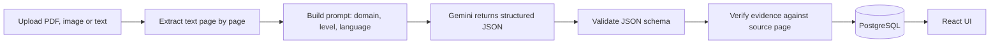

# SimpliCI

**An AI-Based Intelligent Platform for Simplifying Complex Information**

CSE 4104 Software Development III | Northern University of Business and Technology, Khulna
Instructor: Md. Riaz Mahmud, Assistant Professor, Department of CSE

> Status: Week 02, proposal and planning phase. Code scaffolding starts in Week 06.

## Team Information

| Item | Details |
|---|---|
| Team Name | CSE4104-7D-T01 |
| Section | 7D |
| Project Title | SimpliCI: An AI-Based Intelligent Platform for Simplifying Complex Information |
| Team Leader | Utsho Kumar Dey |

| No. | Name | Student ID | Role |
|---|---|---|---|
| 1 | Utsho Kumar Dey | 11230321321 | Team Leader, architecture, AI Integration Lead, GitHub, weekly reports |
| 2 | Md. Adnun Ahemed Methun | 11230321315 | Backend Developer |
| 3 | Madhurjoo Dam | 11230321347 | Frontend Developer |
| 4 | Mst Amena Akter Akhi | 11230321322 | Database Developer |

## Project Description

Students, patients and citizens regularly receive documents they cannot easily understand: research papers, medical reports, policies and official notices. They are long, technical and usually in formal English.

SimpliCI lets a user upload a PDF or image, or paste text. The AI converts it into a simple explanation in **Bangla or English** at a chosen **reading level**. The user can then ask questions that are answered **only from the document**, with page citations. The backend checks the quoted evidence against the real document text before showing an answer.

SimpliCI explains documents. It does not give medical, legal or financial advice. Only dummy documents are used for development and testing.

## Proposed Features

**Core platform (MVP)**
- [ ] F1 Registration and login (JWT, bcrypt), roles: User and Admin
- [ ] F2 Document input: PDF upload, image upload, pasted text
- [ ] F3 Simplification modes: summary, simple explanation, key terms glossary, action items
- [ ] F4 Language (Bangla or English) and reading level (Beginner or University)
- [ ] F5 Domain presets: Academic, Medical Report, Policy or Notice
- [ ] F6 Chat with document: grounded answers, page citations, "not found" response
- [ ] F7 History dashboard with thumbs up or down feedback
- [ ] F8 Admin dashboard: users, usage, feedback

**Differentiators**
- [ ] W1 Evidence verification (cited quote is checked against the source page)
- [ ] W2 Split-view reader with source highlighting
- [ ] W3 Smart Alerts: deadlines, amounts, obligations, warnings
- [ ] W4 Hover glossary for key terms
- [ ] W5 Read aloud in Bangla or English
- [ ] W6 Export to PDF and read-only share link
- [ ] W7 Privacy controls: delete document and data
- [ ] W8 AI quality analytics for admins

**Stretch (one, decided at Week 09):** multi-document search with pgvector RAG, or quiz and viva practice.

## Technology Stack

| Layer | Technology |
|---|---|
| Frontend | React (Vite), Tailwind CSS, react-pdf, Recharts |
| Backend | Node.js, Express.js, Zod, Multer, Helmet |
| Database | PostgreSQL on Supabase (Postgres and Storage only) |
| Authentication | Custom JWT with bcrypt |
| AI | Google Gemini API (model set in `GEMINI_MODEL`), pdf-parse or pdfjs-dist, Gemini vision for scans |
| Deployment | Vercel (frontend), Render (backend), Supabase |
| Tools | GitHub, Postman, Figma, draw.io, dbdiagram.io |

## AI Workflow



## Project Structure

```
frontend/        React (Vite) application
backend/         Node.js and Express API
ai/              Prompt templates and JSON schemas
database/        Schema, migrations, seed data
documentation/   Proposal, SRS, design, reports
screenshots/     UI screenshots for README and reports
presentation/    Slides and demo material
testing/         Test cases, Postman collection, AI test set
```

## Installation Instructions

Planned commands (code scaffolding is added in Weeks 06 and 07):

```bash
git clone https://github.com/UTSHO2628/cse4104-7d-t01-simplici.git
cd cse4104-7d-t01-simplici

# Backend
cd backend && cp .env.example .env   # fill in your own values
npm install && npm run dev

# Frontend (new terminal)
cd frontend && cp .env.example .env
npm install && npm run dev
```

Never commit `.env` files or API keys.

## Deployment Link

To be added in Week 11.

## Screenshots

To be added from Week 05 (Figma designs) and Week 07 (running UI).

## Team Workflow

- Branches: `main` (stable), `development`, `frontend`, `backend`, `ai-integration`
- No direct pushes to `main`. Use pull requests with at least one reviewer.
- Commit messages are meaningful, for example `Added JWT authentication`. See `CONTRIBUTING.md`.

## Roadmap

See `documentation/week-02/CSE4104-7D-T01_ProjectPlan.pdf`.
